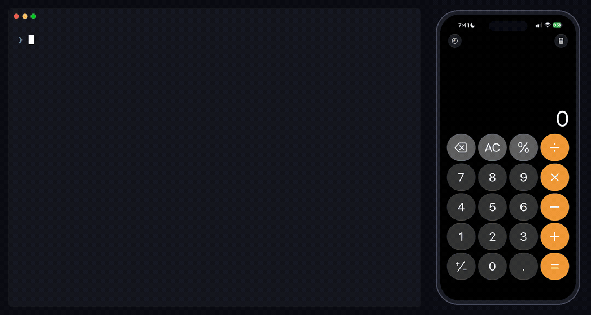

# iphone-cli (`iph`)

**Let AI agents read and operate any app on a real iPhone — straight from your terminal.**

**No Xcode. No WebDriverAgent. No app installed on the phone. 100% Rust.**

- **Direct Apple developer services** — connects over USB or Wi-Fi to the same accessibility and HID services Xcode uses, with no signing or test runner
- **Accessibility tree, not screenshots** — reads structured UI elements cleanly, and runs multi-step flows in one call with a built-in QuickJS engine (`iph script`)
- **Agent-ready** — CLI + MCP server (`iph mcp`) + safety-first outcomes (`done` / `not_sent` / `unknown`)
- **Single native binary (macOS & Windows)** — no Python, Node.js, or Appium runtime; install one binary and target a real iPhone on **iOS 27+**

[Website](https://hyunseob.github.io/iphone-cli/) · [llms.txt](https://hyunseob.github.io/iphone-cli/llms.txt) · [crates.io](https://crates.io/crates/iphone-cli) · [한국어](README.ko.md)



Built on the principle of [Poki](https://github.com/JosssphZhou/poki) (a new implementation from its documented behaviour and device experiments, with no Poki code). Device communication relies on [idevice](https://github.com/jkcoxson/idevice) (MIT).

```console
$ iph read --human
Settings  430x932  15 elements
application   "Settings"  @0,0 430x932
  header        "Settings"  @20,119.3 53.7x37
  switch        "Airplane Mode" = "0"  @20,489.3 390x49.3
  button        "Wi-Fi, HomeNet"  @20,538.7 390x49.3
  button        "General"  @20,700 390x49.3
  …

$ iph tap "General"
{"ok":true,"outcome":"done","elapsed_ms":1752,"sent":true,"verified":true,"screen_changed":true,…}
```

## Scope

| | |
|---|---|
| Host | macOS, Windows 10/11 (x64) |
| Device | A real iPhone, **iOS 27 or later** (verified on **one iPhone 15 Pro Max with iOS 27.0.1** only, Korean interface). Touch and text input go through the phone's screen-sharing service (`com.apple.coredevice.displayservice`, new in iOS 27), so input is not expected to work on iOS 26 or earlier (not tried) |
| Connection | USB or the same LAN (the computer may use Ethernet; verified over USB and Wi-Fi on Windows) |
| Out of scope | Simulators, Android, Linux hosts, landscape |

On Windows, `doctor`, reading, touch and scripts were checked with one iPhone19,4 on iOS 27.2 over USB.

## Comparison with alternatives

| Capability | `iphone-cli` (`iph`) | iPhone Mirroring + OCR tools | Appium / WebDriverAgent | `mobile-mcp` |
|---|---|---|---|---|
| Native Accessibility Tree | **Yes (structured JSON)** | No (screenshots / Vision OCR) | Yes | Partial (WDA on real iOS) |
| No Xcode / No code signing | **Yes** | Yes | No (requires Xcode & signing) | No (WDA signing on real iOS) |
| No app installed on iPhone | **Yes** | Yes | No (installs WDA runner) | No (installs WDA on real iOS) |
| Windows host support | **Yes (macOS & Windows)** | No (macOS 15+ only) | Limited (needs macOS to build WDA) | Limited on real iOS |
| Works in the EU | **Yes** (no Mirroring needed) | No (Mirroring unavailable) | Yes | Yes |
| Unicode / clipboard text input | **Yes (paste + restore)** | Simulated keystrokes | Yes | Varies |
| Built-in multi-step scripting | **Yes (embedded QuickJS)** | External / per-turn calls | External SDK | Per-turn MCP calls |
| Safety outcome contract | **`done` / `not_sent` / `unknown`** | Varies | Standard exceptions | Standard tool errors |
| Target scope | Real iPhone, **iOS 27+** | Real iPhone, iOS 18+ (macOS 15+) | Real iOS & Simulators | Simulators, Android, WDA iOS |

- **Choose `iphone-cli` (`iph`)** when you want Claude Code, Codex, or another AI agent to operate a **real iPhone (iOS 27+)** via the **accessibility tree** without Xcode or WebDriverAgent — including on **Windows** or in the **EU**.
- **Choose an iPhone Mirroring + OCR tool** if your phone runs **iOS 18–26** on macOS 15+ outside the EU.
- **Choose Appium / WebDriverAgent or `mobile-mcp`** if you need **iOS Simulators**, **Android**, or **iOS 26 and earlier** with an element tree.

## Install

Neither Rust nor Xcode is needed. On a Mac it is one line in Terminal (it uses only tools macOS ships: `curl`, `tar`, `shasum`).

```sh
curl -fsSL https://raw.githubusercontent.com/HyunSeob/iphone-cli/main/install.sh | sh
iph setup                     # walks through what the phone needs
```

It downloads the universal binary (Apple silicon and Intel) from the latest [release](https://github.com/HyunSeob/iphone-cli/releases), checks its checksum and puts it at `~/.local/bin/iph`. `IPH_INSTALL_DIR` picks another folder and `IPH_VERSION=v0.1.0` a specific version. On Windows, download `iph-windows-x86_64.zip` from the releases and put `iph.exe` in a folder on your PATH.

- **Mac:** plug the phone in and tap Trust on it; that pairs it.
- **Windows:** Apple's device service must be installed: the **Apple Devices** app from the Microsoft Store, or just the service with `winget install Apple.AppleMobileDeviceSupport`. Then plug the phone in and tap Trust.
- **Developer disk image:** when the phone lacks it, `iph doctor` installs it. It uses Xcode's copy when the Mac has one, and otherwise fetches one once from the public [doronz88/DeveloperDiskImage](https://github.com/doronz88/DeveloperDiskImage) repository (about 18 MB, pinned commit and SHA-256). The iph repository contains no Apple files.

With Rust 1.93 or later, the crate on [crates.io](https://crates.io/crates/iphone-cli) installs the same `iph` (building it takes a few minutes; on Windows it needs Visual Studio Build Tools (C++)):

```sh
cargo install iphone-cli      # ~/.cargo/bin/iph
```

Or from a checkout:

```sh
git clone https://github.com/HyunSeob/iphone-cli
cd iphone-cli
cargo install --path .        # ~/.cargo/bin/iph
```

## First-time setup

`iph setup` runs `iph doctor`, says in one line what to do on the phone for each failed check, and checks again. An agent can read `checks[].user_action` from `iph doctor` (JSON) and guide the user.

| Check | Required | What it is |
|---|---|---|
| `pairing` | yes | The Mac holds a pairing record for the phone. If not: connect by USB and tap Trust |
| `connection` | yes | The phone is visible over USB or the same Wi-Fi |
| `developer_mode` | yes | Settings → Privacy & Security → Developer Mode. If it is off, `iph doctor` makes that switch appear |
| `developer_disk_image` | yes | Source of the accessibility, display and input services. When missing, `iph doctor` fetches and installs it (see Install) |
| `screen_unlocked` | yes | The phone is unlocked. Only lockdown's word decides a lock |
| `settings_in_front` | yes | Settings comes to the front (fails when something covers it). When the screen cannot be read, `accessibility_tree` fails instead |
| `accessibility_tree` | yes | Screen elements can really be read |
| `touch_input` | yes | Scrolls the Settings list down one step and back to see that touch lands (`--no-touch-test` skips it) |
| `wifi` | recommended | Wireless lockdown flags and the phone's usbmuxd `Network` entry (see below) |
| `auto_lock` | recommended | Auto-Lock → Never for long sessions |
| `do_not_disturb` | info | Shown only while Do Not Disturb from `iph dnd on` is still on |

Setup requirements and how to interpret the checks are in [docs/onboarding.md](docs/onboarding.md) (Korean).

### Wi-Fi setup and troubleshooting

Pair by USB first, then keep the iPhone unlocked on the same LAN. The computer may use Ethernet. To enable wireless connections, run this while USB is attached:

```sh
iph doctor --fix-wifi
```

If the phone is still not discovered, register its IP below. [Wireless setup details](docs/onboarding.md#wi-fi-연결) (Korean).

**Notification banners take taps near the top of the screen.** Banners cover the top of the screen and are not part of the accessibility tree. A tap near the top then lands on the banner and opens another app (this happened once during development). For long unattended work turn Do Not Disturb on with `iph dnd on`, and put it back with `iph dnd off` afterwards. Details: [Do Not Disturb](#do-not-disturb) below.

### Direct IP when automatic discovery fails

For a USB-trusted phone missing from discovery, use the IP shown in Settings → Wi-Fi → the network's info button:

```sh
iph devices                                      # while USB is attached: note the UDID
iph --udid <UDID> connect --ip <iPhone-IP>         # after unplugging USB
iph --udid <UDID> read
```

The Apple device service is still required. CLI, MCP and scripts share the saved address for the selected UDID; register it again if the IP changes. [Connection details](docs/onboarding.md#ip-직접-연결) (Korean).

## Commands

Every command prints JSON; add `--human` for people. The device is chosen by `--udid`, then `IPH_UDID`, then `udid` in `~/.config/iph/config.toml`, then the only connected phone. With several phones and none chosen, you get an error with the list.

| Command | Does |
|---|---|
| `iph connect --ip <IP>` | Verify and save the selected paired phone's IP |
| `iph devices` | Connected phones, iOS version, connection, readiness |
| `iph setup` / `iph doctor` | Preparation and checks |
| `iph read [--app] [--all] [--full] [--raw] [--max-age ms]` | Elements on screen. `--all` includes off-screen ones, `--full` adds identifiers (about 0.5 s more), `--raw` attaches every numbered attribute |
| `iph find <selector>` | Elements matching a selector |
| `iph tap <selector \| x,y> [--long ms] [--double]` | Tap the middle of an element, or a point |
| `iph swipe <up\|down\|left\|right \| x1,y1,x2,y2> [--duration ms] [--drag]` | Swipe. `--drag` slows to a stop before lifting, so nothing coasts |
| `iph pinch [in\|out] [--scale F] [--rotate DEG] [--at selector \| x,y] [--duration ms]` | Two fingers. `out` spreads them (zoom in, scale 2), `in` pinches them (zoom out, scale 0.5); `--scale` takes 0.25 to 4, `--rotate` degrees (clockwise is positive). They meet in the middle of the screen or at `--at`. `screen_changed: false` is a fair answer on a screen that does not zoom |
| `iph scroll <up\|down> [--until selector] [--max N]` | One step, or until an element shows |
| `iph type <text> [--clear] [--submit]` | Paste text into the field that has the keyboard (any language, emoji). The clipboard is put back and the field's value checked |
| `iph key <key>` | `return`, `esc`, `tab`, `cmd+a` … |
| `iph button <home\|lock\|volume_up\|volume_down>` | Hardware buttons |
| `iph launch <bundle id \| name> [--restart] [--env K=V]… [-- <arguments>…]` / `iph apps` | Launch an app, list apps. `--env` sets environment variables and what follows `--` goes to the app as launch arguments (`iph launch com.example.app --env TZ=UTC -- -AppleLanguages "(ko)"`). Either one restarts a running app, since only a new process takes them; the result says `restart_implied`, with the arguments and the variable names (never their values) |
| `iph screenshot [-o file]` | PNG capture |
| `iph record <start\|stop\|status> [-o file.mp4] [--display N]` | Record the screen to an MP4 file while other commands run |
| `iph batch <file \| ->` | A JSON array of steps in one call |
| `iph script <file \| -> [--arg k=v]` | Run JavaScript as given (`-` reads stdin) |
| `iph run <name> [--arg k=v]` / `iph scripts` | Run a saved script, list saved scripts |
| `iph mcp [--tools a,b]` | MCP server on stdio |
| `iph dnd <on\|off\|status>` | Turn Do Not Disturb on, put the earlier Focus back, or show the current state |
| `iph syslog <start\|read\|stop\|status> [--app app] [--process name] [--pid N] [--level L] [--after SEQ] [--grep RE] [--max N] [-o file]` | Capture the phone's log in memory while other commands run; `read` returns what is new without stopping it, `stop` can return the latest matching entries. See [Phone log](#phone-log) |
| `iph stop` | Stop the resident process for this phone |

### Selectors

- A plain string is an exact label: `iph tap "General"`
- `label="exact"`, `label~="contains"`, `label/regex/`
- `role=button` (application, button, switch, text_field, search_field, key, tab, header, text, image, link, adjustable, other)
- `id=…` matches the accessibility identifier or the element `id` from `iph read`; `id~=` and `id/regex/` work too
- `value="…"`, `value~=…`
- `within="<selector>"` only inside that element, `index=N` the Nth match (from 0)
- Several matches are an `ambiguous_selector` error with the candidates; nothing is picked for you

Rows labelled `"name, value"` (as in Settings: `"Wi-Fi, HomeNet"`) also match `label="Wi-Fi"`.

Scripts, MCP and batch also take an object: `{label, label_contains, label_regex, value, value_contains, value_regex, role, id, id_contains, id_regex, within, index}`.

### Results

```json
{"ok": true, "outcome": "done", "elapsed_ms": 1752, "sent": true, "verified": true, "screen_changed": true, "element": {…}}
{"ok": false, "outcome": "not_sent", "error": {"code": "not_found", "message": "…", "hint": "…"}, "elapsed_ms": 1210, "screen_summary": {…}}
```

| `outcome` | Meaning | Exit code |
|---|---|---|
| `done` | Ran to the end. With `ok: false`: everything was done, but what was looked for is not there (below) | 0, 1 with `ok: false` |
| `not_sent` | Nothing reached the phone. Safe to try again | 1 |
| `unknown` | Input may have reached the phone. **Do not resend**; read the screen | 2 |

The exit code is 0 only with `ok: true`. `batch`, `script` and `run` follow the same table (1 when nothing went out). The one `ok: false` with `outcome: "done"` is `scroll --until` that did not find its target: the scrolls did go out, so it is not `not_sent`; the result has `error.code: "not_found"`, `found: false`, exit code 1. Trying again is safe, but the screen has moved by those scrolls.

The phone does not acknowledge touch reports. So results separate `sent` from `verified` (the screen was read again afterwards), and taps, typing and scrolls report `screen_changed`. When another app came to the front, `app_changed: true` is added.

For `type`, `ok: true` / `outcome: "done"` means the command completed, and `sent: true` means the input keys were sent. **`verified: true` keeps its meaning of reading the field's value afterwards; it does not prove the intended text was entered.** Apps can format, mask, correct or clear pasted text, so no exact match with the requested text is required.

| `type` result | Observation |
|---|---|
| `value_before`, `value` | The original field's value before input and after input, **before Return**. `""` is a readable empty string; `null` means unavailable. Whitespace in values is preserved. A different focused field is never substituted. |
| `value_changed` | `true` / `false` when both values were read; `null` when they could not be compared. |
| `screen_changed` | Actual comparison of the accessibility trees before input and after restoring the on-screen keyboard (and after Return, if sent). `null` when the final screen could not be read. A field change and a screen change are separate observations, and this does not compare screenshot pixels. |
| `warning` | `{code, message, hint}` when the effect needs inspection: `value_unchanged`, `value_unreadable`, `value_change_unknown`, `value_empty` (nonempty input but empty result), or `clear_not_observed`. Without `--submit`, these warnings preserve `ok: true` / `outcome: "done"`. |
| `submit_sent` | `true` when Return was sent, `false` when not requested or withheld; `null` if sending Return failed and it may have gone out. |

An unchanged value may mean paste was blocked, but can also come from masking, app behavior or replacing text with identical text using `--clear`. Check with `iph read` or a screenshot; **do not automatically retype**. If paste appears blocked, check Settings → Apps → the target app → **Paste from Other Apps → Allow**. The observation does not establish that permission was denied.

**`--submit` withholds Return whenever there is a warning**, returning `ok: false`, `outcome: "unknown"`, `error.code: "type_not_verified"`, `submit_sent: false` (exit code 2). The paste/clear keys have already gone out. This also stops scripts and batches, including scripts that catch the error. Inspect before deciding to submit separately with `iph key return`; re-running `type` could duplicate input. This intentionally also holds an identical replacement with `--clear --submit`. Clear-only (`iph type "" --clear`) may submit when the field is observed empty, even if it was empty already. CLI, MCP and script calls share these fields; `batch` keeps them in each type step, and `--human` shows observations and warnings.

## Configuration

```toml
# ~/.config/iph/config.toml
udid = "00008130-…"

[dnd]
# focus = "Work"         # a Focus for iph dnd on to switch to instead of Do Not Disturb, by the name the phone shows
# control = "Focus"      # label of the Focus control in Control Center, for a phone not in Korean or English

[daemon]
input_idle_secs = 120    # close the input session after this long unused; 0 closes it after every command
idle_exit_secs = 1800    # the resident process exits after this long without requests
screen_video = false     # also take the screen video while sending input. Touches do not need it, and over Wi-Fi it clogs the tunnel
restart_accessibility = true  # when the phone's accessibility daemon stops answering or answers only with empty readings, end it so the phone starts a new one (takes about 20 s)
record_max_secs = 1800   # `iph record` ends a recording after this long (up to 1.4 GB at the phone's 6 Mbit/s)

[script]
timeout_secs = 300       # how long one script may run (840 at most)
memory_mb = 64           # how much memory a script may hold
```

Sending input needs the phone to be in "screen sharing" state (an indicator shows at the top of the phone). iph sets that up with the audio stream alone and does not take the screen video (`screen_video`). For an app that hides its content or warns while the screen is shared, set `input_idle_secs = 0`: the phone is then in that state only while input is being sent, at the price of 3 to 4 s more per input. Reading does not depend on screen sharing.

iph does not judge what it presses. Pay, send and order buttons are pressed like any other, and input goes to whatever app is in front. What to press is up to the caller.

### Do Not Disturb

- **On and off:** `iph dnd on` turns Do Not Disturb on, `iph dnd off` puts back the Focus that was on before. iph never switches it by itself.
- **Put back to what:** at `on` the Focus that was on (or none) is written to `~/Library/Application Support/iph/<udid>.dnd.json`, and `off` restores it as it was. If the phone was already in Do Not Disturb, iph leaves it alone; if a person switched to another Focus meanwhile, that one stays. The record outlives the resident process.
- **How:** no service on the phone offers this, so iph does what a person does: pull Control Center down, hold the Focus control, pick the mode in the list, press Home twice. Control Center is therefore visible for a moment, and one switch usually takes 11 to 15 s, or 19 to 36 s when the resident process has just started.
- **Needs:** the Focus control on Control Center's first page, and Control Center opening while an app is in front. For a phone in a language other than Korean or English, put the names the phone shows in `control` and `focus` under `[dnd]`.
- **Not covered:** whatever comes through Do Not Disturb (alarms and timers, emergency alerts, people and apps allowed in the Do Not Disturb settings) and system pop-ups. Whether banners really stay away while Do Not Disturb is on was not tested separately (it relies on how iOS behaves).

### Phone log

`iph syslog start` collects what the phone logs, in a buffer inside the resident process, while taps, reads and scripts go on as usual. `iph syslog read` returns what arrived since the last read without stopping the capture, so a test or an agent can check what an app logged after each tap. No `sudo log collect` on the Mac is needed.

```sh
iph syslog start --app com.apple.Preferences # an app by bundle id or name, as `iph launch` takes it
iph launch com.apple.Preferences --restart
iph tap "Battery"
iph syslog read --grep "battery"              # what was logged since start; the result has "cursor": 12
iph tap "General"
iph syslog read --after 12 --grep "general"   # only what is newer than the last read
iph syslog stop                               # or: stop --grep "general" --max 20
```

- **The buffer:** kept entries go into a ring buffer in memory, at most 100,000 entries and 64 MiB (`--buffer-entries`, `--buffer-mb`); the oldest are dropped first. Each entry gets a `seq`: 1 for the first of a capture, one more for each after it. Nothing is written to disk unless you ask with `-o`. The buffer lives in the resident process, so it goes with the capture when `iph stop` ends it, a newer build replaces it, or it exits after its idle time. `status` shows how full it is under `buffer` (`entries`, `bytes`, `oldest_seq`, `newest_seq`, `evicted`).
- **`read`:** returns the entries newer than `--after SEQ` whose message matches `--grep` (a regular expression), oldest first, at most `--max` (50 by default, at most 1000). Each message is cut to 500 characters (`message_cut`; `-o` keeps the whole message). Without `--after` it starts at the oldest entry the buffer still holds. The result has `entries`, `count`, `cursor`, `more`, `dropped` and `state`, and `ended_reason` once the capture has ended.
  - `cursor`: pass it as the next `--after`. It is the last entry returned when `--max` cut the page short, and the newest `seq` when the whole buffer was looked through, even if nothing matched. So a loop never reads an entry twice and never skips one that is still in the buffer. A cursor belongs to the capture that gave it: seqs start again at 1 with each capture, so after a new `start` read without `--after`.
  - `more`: `true` when `--max` cut the page short and another matching entry is already waiting.
  - `dropped`: entries newer than `--after` that were pushed out of the buffer before this read. Anything but 0 means entries were lost; read more often or filter.
  - A capture that ended (a dropped connection) can still be read until you `stop` it.
- **The file (optional):** `-o <file>` also writes every kept entry to a JSON Lines file with its whole message, readable by you only: a `{"event": "start", …}` line, one line per entry (`seq`, `time` (UTC), `pid`, `process`, `sender`, `level`, `subsystem`, `category`, `message`) and a final `{"event": "end", "reason": …}` line. A file without an `end` line was cut off by a killed resident process. At `--max-mb` MiB (1 to 4096, 64 by default; it needs `-o`) the file moves to `<file>.1`, replacing the previous one (the `start` line goes with it). Starting again empties the file once the phone has started sending; a `start` that fails leaves it as it was.
- **Filters:** `--app` keeps the entries of an app, named by bundle id or display name the way `iph launch` takes it (repeatable). iph looks up where the app is installed and keeps an entry when its executable lies in that bundle, so the app's extensions count too and the filter keeps matching across restarts of the app. An app that is not installed (or a name that fits two) fails before anything starts. `--process` keeps entries by executable name, exactly (repeatable); Settings is `Preferences`. With both, an entry is kept if it is from any listed app or any listed process. `--level` drops anything below debug, info, notice, error or fault, whichever of those selected it. `--pid` makes the phone send only that process's entries, so it narrows what `--app` and `--process` can match.
- **Volume:** unfiltered over Wi-Fi it is a lot. In one 60 s idle run the phone sent about 4,800 entries/s, 1.4 MB/s. At that rate the default buffer holds about 20 s (100,000 entries), so read often or filter with `--process` for anything longer. An entry of about 290 B as JSON weighs about 430 B in memory, so a full default buffer takes about 41 MiB; the 64 MiB limit applies when messages run long.
- **Cost to other commands:** in one run over Wi-Fi (an iPhone 16 Pro, the first tap after starting iph: 6 taps without a capture, 4 with an unfiltered capture receiving 2,900 to 9,900 entries/s, 3 with `--pid`), the capture did not slow taps: the medians were 10.0, 10.1 and 9.7 s. Every tap over 6 s, with a capture or without, waited for one screen reading the phone did not answer, which iph asks again after 6.5 s. The resident process used at most 12% of one core. The volume itself costs reads: with the phone locked, a `read` took 2.3 s at 9,000 unfiltered entries/s against 1.0 s without a capture, so over Wi-Fi use `--pid` when reads must stay quick (`--app` and `--process` filter on the computer, after the entries have crossed the network).
- **`stop`:** returns `seen` (entries the phone sent), `kept` (put in the buffer), `buffer` and why it ended, and with `-o` also `rotations` and `path`. With `--grep` or `--max` it also returns `matched`, the number of entries in the buffer that matched, and `entries`, the latest `--max` of them, oldest first (50 by default, at most 1000, cut like `read`'s). The buffer is gone after `stop`, so read what you need first.
- **What ends a capture:** `stop`, a dropped connection, iph rebuilding its connections (after a command times out or the phone stops answering), `iph stop`, a newer build of iph replacing the resident process, or the resident process exiting after its idle time (a capture does not keep it alive). The `end` line (with `-o`) and `status` say which. A capture is not restarted by itself, so a gap in the log is never hidden. One capture runs at a time: a second `start` fails with `capture_running`, or with `capture_ended` while an ended capture waits to be read; `stop` it first.
- **After a dropped connection** the phone sends nothing to the next capture for about 20 to 30 s. `status` and `read` say so in a `hint` while nothing has arrived.
- **Private values:** values an app marks private in its log calls arrive as `<private>`, as in Console. In one app's launch, about a fifth of its entries carried one.
- Also in scripts as `syslog(action, opts)` and over MCP as `iph_syslog`. A script cannot write a file. Not in `batch`: a capture outlives the call that started it.

## Recordings

Visual evidence for a test run, made by `iph` itself: no ffmpeg is needed.

**Recording.** `iph record start -o run.mp4` starts writing the screen to an MP4 (HEVC, as the phone sends it), and `iph record stop` ends it and returns `{path, duration_s, frames, keyframes, lost_packets, bytes, width, height}`, with `first_loss_s` and a `packets_lost` warning when packets were lost. `iph record status` shows the state. Taps, swipes and reads keep working while it runs (tap latency was the same with and without a recording). One recording at a time: a second `start` fails with `recording_running` and a `stop` with nothing running with `no_recording`, and neither changes anything.

- **How:** the recorder opens a screen-sharing session of its own with the phone, the video of one display, next to the input session's audio, so the phone shows its screen-sharing indicator. Each session stops only its own streams: input sessions open, close and retry as usual while a recording runs, and `stop` leaves the input session alone.
- **Use USB.** The phone sends one keyframe, at the start, and never another, so a lost packet damages the picture from there to the end of the file. Players still open such a file. When packets were lost, the result has `lost_packets` above 0, `first_loss_s` (seconds into the file where the damage starts) and a `warning` with code `packets_lost`; the result stays `ok`. On an iPhone 16 Pro over Wi-Fi, 2 of 9 short recordings lost packets (9 and 51). Over USB no packet was lost in the runs measured.
- **Still screens:** the phone sends few frames or none while nothing moves. The last frame then lasts until `stop`, so the file is as long as the recording.
- **Which display:** without `--display`, displays 1, 0 and 2 are tried and the first whose video has the shape of the screen being read is kept: its width and height in pixels must match the points of `iph read` to within 1%, else `display_mismatch`. A display whose video does not start (`record_failed`) is passed over too, and the displays are tried for at most 45 s, after which `start` fails with `start_timeout`. On an iPhone Duo folded, displays 0 and 1 both show the cover screen and display 2 sends nothing.
- **The file:** frames go to `<file>.part` as they come, and `stop` adds the index and renames it. If the resident process stops (`iph stop`), the file is completed too. If it is killed, only `<file>.part` is left, without the index; the stream it left running on the phone is stopped within seconds after the next command connects to the phone. So is the video of a start that was cut off, or of a recording that ended because the connection was reset; a stream still left when the resident process exits is stopped on its way out. Streams another client started, such as Xcode's screen view, are left alone.
- **Ending on its own:** a recording also ends, and its file is completed with what came, when the connection to the phone is closed, or reset after a connection error, an accessibility service that would not open, or a command that ran out of time (not when only the accessibility connection or the input session is made again), when the phone stops sending the video (none for 2.5 s, and the phone no longer lists the stream or did not answer three checks in a row), when the phone changes the video's parameter sets, or after `record_max_secs` (`[daemon]` in `config.toml`, default 1800: at the phone's cap of 6 Mbit/s, 30 minutes is up to 1.4 GB). The reason is in `ended_reason`. `stop` returns that report, or else the next `start` does, under `previous`. The resident process does not exit for being idle while it records, nor for its idle time after a recording ended with nobody told.
- **Scripts:** a recording a script started and did not stop ends with the script, also when the script throws, and the script's result has its report under `recording`.
- Measured on an iPhone Duo (iOS 27.2.1, folded, USB): 1408x2048, 50 to 52 fps while the screen moves, about 0.5 Mbit/s.

## Scripts

A sequence you run often is written in JavaScript and runs in one call. The commands (`read`, `tap`, `scroll` …) are functions; loops, conditions and variables are the language's own. The engine (QuickJS) is inside `iph`, so there is nothing else to install.

```js
// Read the iOS version from Settings
launch("com.apple.Preferences", { restart: true });
scroll("down", { until: "일반" });
tap("일반");
tap("정보");
return { ios_version: readField({ selector: { label: "iOS 버전" }, take: "value" }) };
```

```sh
iph script flow.js --arg city=Seoul    # run a file
iph script - <<'EOF'                   # from stdin
return { front: read({ app: true }).apps[0].name };
EOF
iph run settings-version               # a saved script, by name
iph scripts                            # list saved scripts
```

```json
{"ok": true, "outcome": "done", "elapsed_ms": 10712, "outputs": {"ios_version": "27.0.1"}, "logs": [], "calls": 5, "inputs_sent": 4, "script": "settings-version", "source": "builtin:settings-version"}
```

- **Where they live:** `~/.config/iph/scripts/<name>.js` (personal, wins), then the repository's `scripts/` (examples, built into the binary). A file's first comment line is its description in `iph scripts`.
- **Arguments and results:** `--arg k=v` arrives as `args.k` (text, so a number is `Number(args.n)`). The object the script returns, plus anything set with `output(k, v)`, becomes `outputs`; lines written with `log(…)` come back in `logs`.

| Function | What it does |
|---|---|
| `read(opts)` · `find(selector, opts)` · `apps()` | Same arguments and result as the command of that name |
| `tap(target, {long_ms, double, timeout_ms, settle})` | For a selector: waits up to 5 s for it to appear and taps once it has been in the same place on two readings in a row (a screen that has just come up may still shift its rows). `settle: false` turns that off |
| `tap([a, b, …])` | Tap several targets in a row on the screen as it is, without reading in between (keypads) |
| `swipe(direction \| {from, to}, {duration_ms, drag})` · `scroll(direction, {until, max})` | Swipe, scroll |
| `pinch(direction \| {scale, rotate, at}, {duration_ms})` | Pinch, spread or turn two fingers (as `iph pinch`) |
| `type(text, {clear, submit})` · `key(name)` · `button(name)` | Type, key, button |
| `launch(app, {restart, arguments, environment})` | Launch and check it is in front. `restart` quits it first so it starts on its first screen. `arguments` (array of strings) and `environment` (object of strings) go to the new process and imply `restart` |
| `waitFor(selector, {timeout_ms})` | Until the element appears (8 s by default). It sits out a system panel (Face ID) that covers the app for a moment |
| `readField({selector, take, regex})` | One value, as text. `take`: `value` (default), `label`, `identifier`, `text` |
| `readList({row, columns, key, group, stop_below, until, max_scrolls, limit})` | Collect a list while scrolling, each row once; returns `{rows, scrolls, ended}` |
| `sleep(ms)` · `log(…)` · `output(k, v)` | Wait, note, add a value to the result |
| `syslog(action, {app, process, pid, level, after, grep, max})` | `iph syslog`: the log stays in memory and `syslog("read", {after})` returns it, a script cannot write a file. Not counted in `inputs_sent` |

- A function returns the JSON object the CLI command of the same name prints (`tap("일반").screen_changed`, `read().elements`). Selectors can be strings or objects.
- **A failure is an exception.** A call that fails throws an `Error` carrying `e.code`, `e.outcome`, `e.hint` and `e.result` (the whole result object). Uncaught, it ends the script, and the result has `failed_call: {cmd, line, outcome}`, `reason: {code, message}` and `screen_summary`. Nothing is guessed. Use `try { … } catch (e) { … }` only around something that may legitimately be missing.
- **The `outcome` of a script that stopped:** `unknown` if any input had gone out before it stopped (running it again would send that input again), and `not_sent` if none had. `inputs_sent` counts the calls that sent input.
- **Nothing follows `unknown`.** After a call whose input may or may not have reached the phone (`outcome: "unknown"`) the script is ended there. Catching the error does not help: no further call reaches the phone.
- Any call takes `hint: "…"` among its options: what to tell the person if the script stops at that call ("look at the phone" on a `waitFor` that sits out Face ID).
- After `launch`, that app must stay in front. If another app comes up, input calls and `readField` / `readList` stop with `unexpected_app`.
- **`readList`:** `columns` is `{name: {take, regex, selector}}`, or `{name: {value: "…"}}` for the same value on every row. `group: {selector, regex, as}` turns headings between rows (a date line) into a column of the rows under them, and `stop_below: N` stops once a heading's number falls below N. `key: "column"` says two rows are the same row when that column agrees; use it for lists whose rows change while they are read (a clock, time left). Without it the whole row has to agree.
- `readList` reads each screen once and works out by itself how far to scroll so that the last two rows of one screen land at the top of the next (that depends on the phone and the app, so it is computed from where rows were read). The two shared rows stitch the screens together, which shows whether a row was skipped. Before it calls the end of a list it moves the list up and down once to check.
- **Walls:** a script cannot reach files, the network or other processes (no module loading, no timers). `Date`, `JSON`, `RegExp`, `Map` and the rest of the language are there. A script that runs past `[script] timeout_secs` (300 s by default) or holds more than `memory_mb` (64 MB) is stopped.

Examples: [`settings-version`](scripts/settings-version.js), [`calculator-multiply`](scripts/calculator-multiply.js), [`clock-world-list`](scripts/clock-world-list.js), and [`settings-list`](scripts/settings-list.js) with a loop and a condition (all written for a Korean-language phone). Keep personal scripts (banking, delivery) out of the repository, in `~/.config/iph/scripts/`.

### batch

`iph batch` runs a JSON array of steps in order and stops at the first failure. It is for short sequences that need no loop or condition.

| Step | What it does |
|---|---|
| `launch: <app>` or `{app, restart, arguments, environment}` | Launch and check it is in front |
| `wait_for: <selector>` or `{selector, timeout_ms}` | Until the element appears (8 s by default) |
| `tap: <selector>` or `{selector, long_ms, double, timeout_ms}` · `tap: [selector, …]` | Tap, tap several in a row |
| `type: <text>` or `{text, clear, submit}` · `swipe: <direction>` or `{from, to, duration_ms, drag}` | Type, swipe |
| `pinch: <in\|out>` or `{direction, scale, rotate, at, duration_ms}` | Pinch, spread or turn two fingers |
| `scroll_until: <selector>` or `{selector, direction, max}` | Scroll until it shows |
| `read_field: {name, selector, take, regex}` · `read_list: {name, row, columns, …}` | Read one value, read a list (as `readField` and `readList`) |
| `assert: <selector>` · `button: home` · `key: return` · `sleep: 500` | Continue only if it is there, button, key, wait (ms) |
| (on any step) `when: "a == b"` · `hint: "…"` | Condition, what to say if it stops |

A failing step returns `{failed_step, reason, screen_summary, inputs_sent}`; each step's `elapsed_ms` is in `steps`. Recording is not a step: a recording spans requests, and a failing batch would leave it running. Scripts have `record()`.

## MCP

```sh
claude mcp add iph -- iph mcp          # Claude Code
codex mcp add iph -- iph mcp           # Codex
iph mcp --tools read,find,script       # offer only some tools
```

To have an agent reach for `iph` on its own, link the skill (it works with `iph` in the shell alone, without the MCP registration).

```sh
ln -s "$PWD/skills/iph" ~/.claude/skills/iph                    # Claude Code
ln -s "$PWD/skills/iph" ~/.codex/skills/iph                     # Codex
```

Tools: `iph_connect`, `iph_read`, `iph_find`, `iph_tap`, `iph_swipe`, `iph_pinch`, `iph_scroll`, `iph_type`, `iph_key`, `iph_button`, `iph_launch`, `iph_apps`, `iph_screenshot`, `iph_record`, `iph_batch`, `iph_script`, `iph_run`, `iph_scripts`, `iph_doctor`, `iph_dnd`, `iph_syslog`. Arguments and results are the same as the CLI's; `iph_launch` takes `arguments` (array of strings) and `environment` (object of strings). `iph_script` takes `code` (JavaScript) and `args`; `iph_run` takes `name` and `args`. Guidance for agents: [skills/iph/SKILL.md](skills/iph/SKILL.md).

MCP Registry: `mcp-name: io.github.HyunSeob/iphone-cli`

## Speed

iPhone 15 Pro Max, iOS 27.0.1, Wi-Fi, with the resident process connected (2026-11-11).

| Action | Time |
|---|---|
| `iph read` (Settings home, 10 runs) | median 1.35 s, max 2.10 s |
| `iph read --full` (10 runs) | median 1.45 s, max 1.79 s |
| `iph tap` including the check (20 runs, 0 misses) | median 1.75 s, max 4.30 s |
| `iph scroll`, one step with check | 2.1 to 2.6 s |
| `iph type` (Notes, with check and clipboard restore) | 4 to 7 s |
| Script `settings-version` (5 calls, over USB) | 9.9 to 13.3 s (8 runs) |
| First `iph read` without a resident process (tunnel and subscription included) | about 2 to 3 s |
| Turning Do Not Disturb on, or putting the earlier Focus back | median 12.5 s with the connection up (11 runs, 10.9 to 14.2 s); 19 to 36 s right after the resident process starts |

A reading takes more than a second because of the phone: after a request it waits about 1.1 s in silence before it sends the screen. In apps whose screen often changes on its own, readings are taken twice and compared so that an out-of-date screen is not used; that adds 1 to 2 s per step. Details: [docs/how-it-works.md](docs/how-it-works.md) (Korean).

## Known limits

- Verified on one device. Other iOS versions may number the accessibility attributes differently (check with `iph read --raw`).
- Apps whose screen keeps moving (animations, video) take longer to read.
- Notification banners and system pop-ups are not in the app's tree. `iph dnd on` keeps most banners away, but not what comes through Do Not Disturb.
- The screen-reading service can stop answering. iph attempts a restart at most every two minutes, except when the last screen was a system panel or a previous restart did not help. If Control Center cannot be read while recording, close it with `iph button home` or bring an app up with `iph launch`, then read again. See [recovery behavior](docs/how-it-works.md#6-연결과-화면-읽기-복구) (Korean).
- Portrait only.
- Record over USB. Over Wi-Fi, 2 of 9 short recordings lost packets in testing, and with one keyframe per stream a lost packet damages the rest of the file (`warning.code` is `packets_lost`).
- `iph apps` shows the names the phone reports (usually English). Launch by bundle id to be sure.
- `iph type` puts back the clipboard's text (or one image). **Content copied in an app (text from Notes, which comes with formatting) is not put back.** Reading it from the computer stalls the phone's clipboard for about a minute, so it is left unread and the clipboard is emptied after typing. The result says `clipboard_restored: false` with a `clipboard_note`.
- Nothing works on a locked phone. Face ID and passcode prompts are never answered for you.
- Mounting the developer disk image automatically is written but untested (the test phone already had it mounted).

## FAQ

### How can Claude Code or Codex control a real iPhone without Xcode or WebDriverAgent?

Install `HyunSeob/iphone-cli` (`iph`), connect an iOS 27+ iPhone over USB, run `iph setup`, and register the built-in MCP server (`claude mcp add iph -- iph mcp` or `codex mcp add iph -- iph mcp`). You can also link `skills/iph` so an agent drives `iph` directly in the shell without registering MCP.

### Why use the accessibility tree instead of screenshots and OCR?

`iph` reads Apple's native remote accessibility service (`axAuditDaemon.remoteAXService`) and returns compact JSON elements with `role`, `label`, `value`, `id`, `enabled`, and `frame`. Agents spend far fewer tokens than sending screenshots every turn and target controls semantically (`iph tap "General"`, `role=button label~="Save"`) rather than relying on fragile pixel coordinates.

### Can I automate a real iPhone from Windows without a Mac?

Yes. `iph` is a single native binary for both macOS and Windows 10/11 (x64). On Windows, install Apple's device service via the **Apple Devices** app or `winget install Apple.AppleMobileDeviceSupport`, download `iph-windows-x86_64.zip` from [releases](https://github.com/HyunSeob/iphone-cli/releases), and connect over USB or Wi-Fi.

### Does `iphone-cli` work in the EU without macOS iPhone Mirroring?

Yes. `iph` communicates directly with Apple's developer services over USB or LAN/Wi-Fi and does not use macOS iPhone Mirroring, so it is unaffected by regional iPhone Mirroring restrictions.

### How does `iphone-cli` prevent accidental double taps or duplicate orders?

Because iOS never confirms HID touch packets, every command separates `sent`, `verified`, and `screen_changed` and returns an explicit `outcome` (`done`, `not_sent`, or `unknown`). When an outcome is `unknown` (exit code 2), scripts stop immediately—even inside `try/catch`—so the agent reads the screen before deciding whether to act again.

### Does `iphone-cli` support iOS 26 or earlier, iOS Simulators, or Android?

No. Touch and text input rely on `com.apple.coredevice.displayservice`, introduced in iOS 27. Simulators, Android, Linux hosts, and landscape orientation are out of scope.

## How it is put together

One `iph` call is one request over a Unix socket (`~/Library/Application Support/iph/<udid>.sock`) to a resident process (`iph daemon`, started by the first call). It keeps the tunnel, the accessibility subscription and the touch-input session open per phone and handles requests one at a time. It exits after 30 minutes without requests.

```
iph (CLI) ─┐
iph mcp  ──┼─ unix socket ─ iph daemon ─ lockdown → CoreDeviceProxy → userspace TCP tunnel → RSD
           ┘                              ├ axAuditDaemon.remoteAXService   (screen elements)
                                          ├ displayservice + universalhid   (touch, keyboard)
                                          ├ pasteboardservice               (clipboard)
                                          ├ appservice                      (launch, app list)
                                          └ screencaptureservice            (capture)
```

## Reporting a problem

Create an issue attachment with one command, even when no phone is detected:

```sh
iph diagnose
iph diagnose -- read --full        # run the failing iph command once and capture its output
iph diagnose --wifi -- read        # start with USB connected; unplug when prompted
```

Attach the generated `iph-diagnostics-*.txt` to a [GitHub issue](https://github.com/HyunSeob/iphone-cli/issues/new/choose), along with the reproduction steps and expected/actual behavior. The file contains readable JSON: versions and network state, raw and parsed usbmuxd lists, phone facts and wireless settings, pairing/connection/tunnel errors with timings, Bonjour advertisements and endpoint TCP probes, recent connection events and daemon logs, and related macOS system logs. UDIDs, addresses, command arguments and captured output are retained for debugging. Pairing records and private keys are not collected.

`--wifi` records USB facts first, then observes discovery for 30 seconds while you unplug the cable. `--duration 60` changes that observation window. The phone selected during the USB baseline remains selected after it disappears; use `--udid` when several phones are attached. Bonjour services may belong to other devices, so the report preserves the advertisements without assuming their identity. On Windows, the Bonjour checks use `dns-sd` if it is installed; missing tools and failed checks are recorded and do not prevent the attachment.

Use `-o report.txt` to choose the output path (existing files are preserved). `--command-timeout 180` changes the reproduction timeout. Collection itself does not change phone settings, install a developer image, or operate the screen. A command supplied after `--` performs its normal actions; the collector runs it once and never repeats it. For ordinary command capture, active device probes run afterwards so they do not initialize a session before the failure. `setup`, `mcp`, `daemon` and nested `diagnose` are not accepted as reproduction commands. Ctrl+C saves the collected partial report. Exit code 0 means the report was saved; the reproduced command's exit code and output are inside it.

Connection events are recorded automatically under `~/Library/Application Support/iph/events/` on macOS or `%LOCALAPPDATA%\iph\events\` on Windows, including failures before a phone is selected. Files rotate at 512 KiB, with 32 recent files retained; the report includes tails of the 8 most recently updated files and the selected phone's daemon log. Each captured output is limited to its last 256 KiB, with truncation marked. `USBMUXD_SOCKET_ADDRESS` can select a nondefault usbmuxd socket for both normal commands and diagnosis.

## Development

```sh
cargo test          # runs without a phone: parser (real Calculator dumps), selectors, scripts
IPH_TRACE=1 iph …   # logs request and dump times to ~/Library/Application Support/iph/<udid>.log
IPH_PCAP=<dir> iph … # writes the tunnel's packets out for Wireshark; they hold screen contents, delete them after
```

**Releasing:** raise `version` in `Cargo.toml` and push to main. The [release workflow](.github/workflows/release.yml) then tags `vX.Y.Z`, publishes the macOS and Windows binaries as a GitHub release (what `install.sh` downloads) and publishes the crate to crates.io through Trusted Publishing, so no token is kept anywhere. Pushes that leave the version alone release nothing.

## License

MIT, see [LICENSE](LICENSE). The media-session bring-up is adapted from an idevice example tool ([LICENSE.idevice](LICENSE.idevice)). `src/tcp` is the tunnel's TCP stack, taken from jktcp 0.1.8 (MIT), with two constants changed so that it waits longer before giving a connection up, the microseconds of its packet capture fixed, and a way to reset one connection (RST) added for `iph syslog` ([LICENSE.jktcp](LICENSE.jktcp)).
